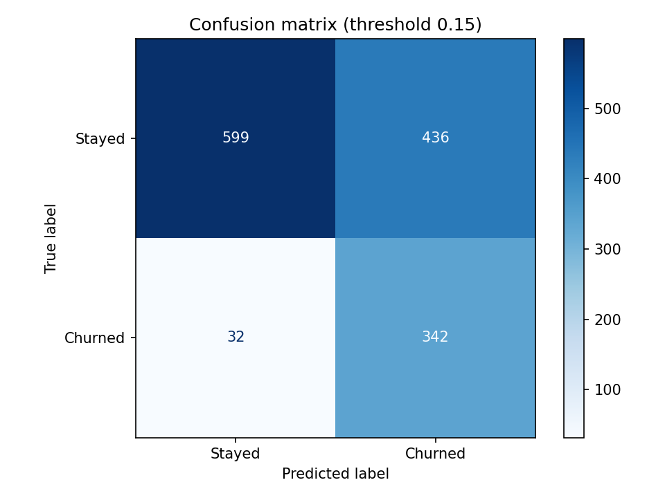
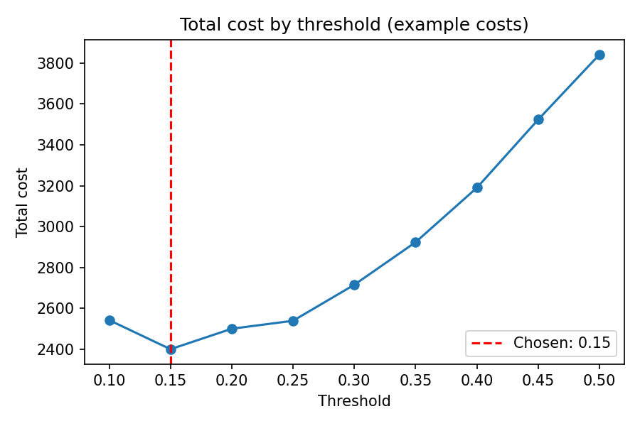
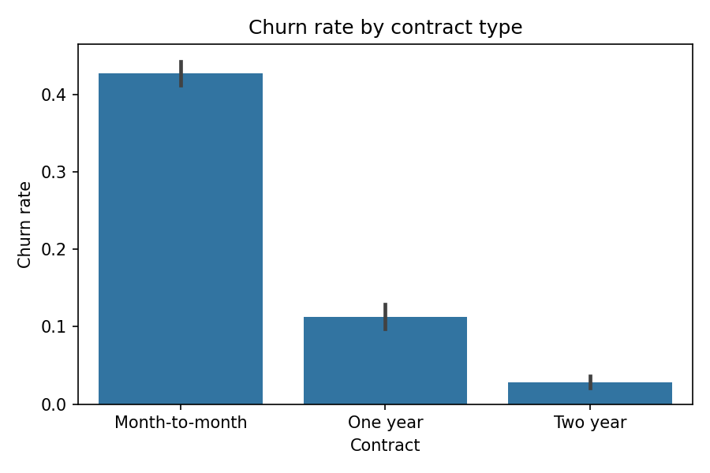
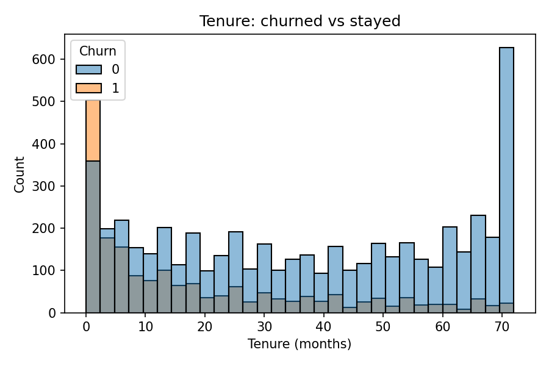

# Telco Customer Churn Prediction

Predicting which telecom customers are likely to leave, and choosing a call list that saves money.

## Business Problem

When a customer leaves (churns), the company loses revenue. Winning a new customer usually costs more than keeping an existing one. If we can find the customers who are likely to leave, the company can offer them a discount or a call, and spend money only on the people who need it.

**Goal:** build a model that gives each customer a churn probability, then choose a cutoff (threshold) that fits the business cost.

## Dataset

- Source: [Telco Customer Churn on Kaggle](https://www.kaggle.com/datasets/blastchar/telco-customer-churn)
- 7,043 customers and 21 columns
- Target column: `Churn` (Yes/No)
- About 26.5% of customers churned, so the classes are imbalanced

The CSV file is not included in this repository. Please download it from the Kaggle link above.

## Approach

1. **Data cleaning:** `TotalCharges` was stored as text because 11 rows had a blank space. I converted it to numbers. These 11 customers have `tenure = 0` (brand new, not billed yet), so I filled their `TotalCharges` with 0. I also dropped `customerID`.
2. **EDA:** compared churn rates across all categorical columns, and looked at tenure and monthly charges for churned vs stayed customers.
3. **Train/test split:** 80/20 with `stratify` so both parts keep the same churn rate (about 26.5%).
4. **Preprocessing:** one-hot encoding for categories and standard scaling for numeric columns, inside a `ColumnTransformer`. Fitted on training data only to avoid data leakage.
5. **Models compared with 5-fold cross-validation:** Logistic Regression, Random Forest (depth 6), and Gradient Boosting.
6. **Threshold tuning:** chose the threshold using cross-validated training predictions and a cost rule, not the test set.
7. **Final test:** evaluated once on the test set.

## Key Findings

| Finding | Number |
|---|---|
| Month-to-month contracts churn the most | about 43% churn (one-year: 11%, two-year: 3%) |
| New customers leave early | churners stayed 17 months on average, stayers 37 months |
| Fiber optic customers churn more than DSL | about 42% vs 19% |
| Electronic check users churn the most among payment methods | about 45% |
| Customers without tech support churn more | about 42% vs 15% with support |
| Senior citizens churn more | about 42% vs 24% |

Note: these are relationships in the data, not proof of cause.

## Model Results

**Model comparison (5-fold cross-validation, ROC-AUC):**

| Model | ROC-AUC |
|---|---|
| Logistic Regression | 0.846 |
| Random Forest (depth 6) | 0.847 |
| Gradient Boosting | 0.848 |

The three models are statistically tied (the differences are smaller than the spread between folds). I chose **Logistic Regression** because it is simple, fast, and easy to explain. On the test set its ROC-AUC is 0.842.

**Final result on the test set at threshold 0.15:**

| Metric | Value |
|---|---|
| Churners caught (recall) | 91% (342 of 374) |
| Precision | 44% |
| False alarms | 436 |
| Missed churners | 32 |



### Choosing the threshold

By default a model flags a customer when the churn probability is above 0.5. That missed too many churners (recall was only 0.54 at 0.5 in cross-validation). Since losing a customer costs more than sending a discount, I lowered the threshold.

I used **example costs**: a discount (or call) costs 1 unit and a lost customer costs 5 units. The lowest total cost in cross-validation was at a threshold of **0.15**.



**Cost on the test set (example costs):**

| Strategy | Total cost |
|---|---|
| Call nobody | 1,870 |
| Call everybody | 1,035 |
| **Model at threshold 0.15** | **596** |

This is about 68% lower than calling nobody and about 42% lower than calling everybody.

**If the team can call only 100 customers:** calling the 100 highest-risk customers gave a precision of 73%, compared with about 26.5% for calling random customers. That is about 2.7 times better than random.

## What Drives Churn

I used the Logistic Regression coefficients to see the main drivers.

- **Lower churn:** longer tenure, two-year contract, DSL internet
- **Higher churn:** fiber optic internet, month-to-month contract, electronic check




Some columns overlap (for example `tenure` and `TotalCharges`, or `MonthlyCharges` and the internet and streaming columns), so I only trust the large, clear signals above and do not read the small coefficients one by one.

## Business Recommendations

1. Offer month-to-month customers a small discount to move to a one-year plan.
2. Check fiber optic customers for price or service problems.
3. Give extra care and offers during the first 6 to 12 months.
4. Encourage automatic payment instead of electronic check.

## Limitations

- The costs (1 and 5) are **example values**. With the company's real costs, the best threshold may change.
- The cost calculation assumes a discount always stops a customer from leaving. In real life it will not, so a small pilot test is needed.
- The data shows relationships, not causes.
- The dataset is a single snapshot, so I could not check how the model behaves over time.

## How to Run

1. Download the dataset from Kaggle and place `WA_Fn-UseC_-Telco-Customer-Churn.csv` next to the notebook.
2. Install the libraries:
   ```
   pip install -r requirements.txt
   ```
3. Open `notebook.ipynb` and run all cells.

To use the saved model:

```python
import joblib

saved = joblib.load("churn_model.joblib")
probs = saved["pipeline"].predict_proba(new_customers)[:, 1]   # churn probability
flags = (probs >= saved["threshold"]).astype(int)              # 1 = likely to churn
```

`new_customers` must be a table with the same 19 columns as the training data (everything except `customerID` and `Churn`).

## Tools Used

Python, pandas, NumPy, scikit-learn, matplotlib, seaborn, joblib, Google Colab

## Author

**[Mehreen]**
LinkedIn: [https://www.linkedin.com/in/mehreen-ghazanfar-52b680280/]
GitHub: [https://github.com/MehreenGhazanfar26/Telco-churn-prediction/edit/main/README.md]
